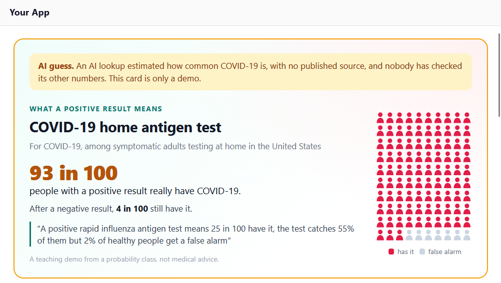
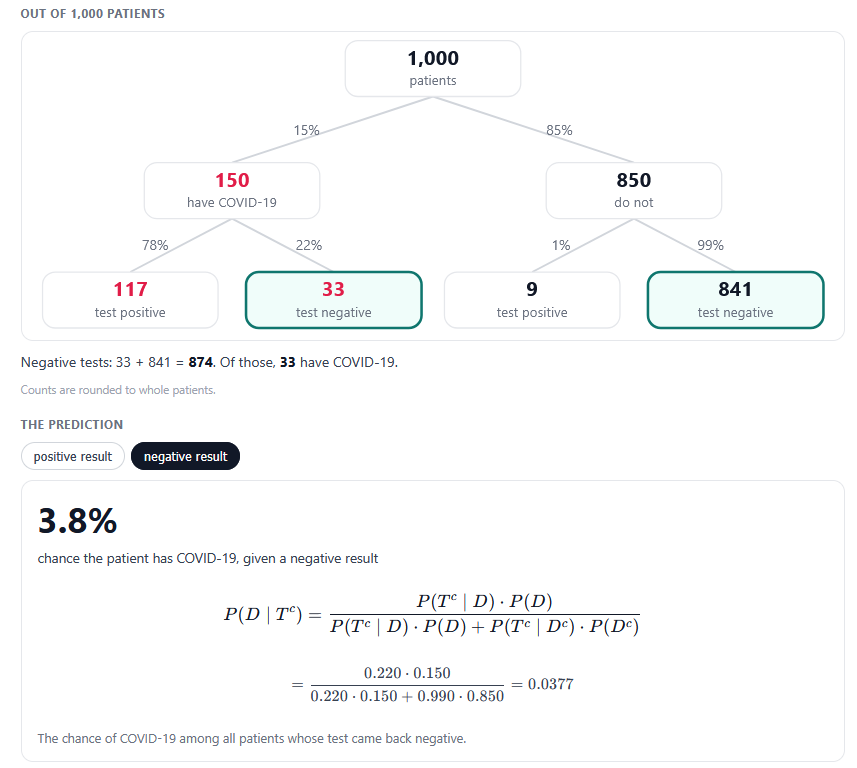
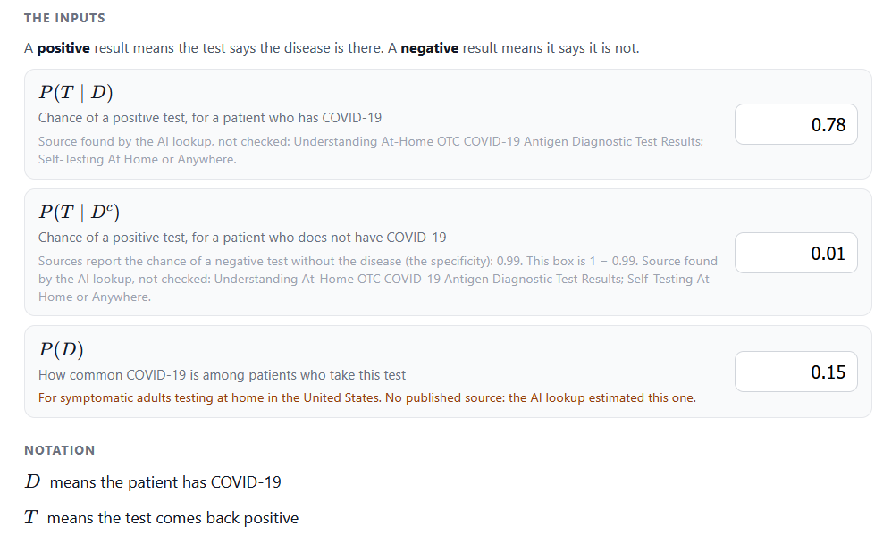
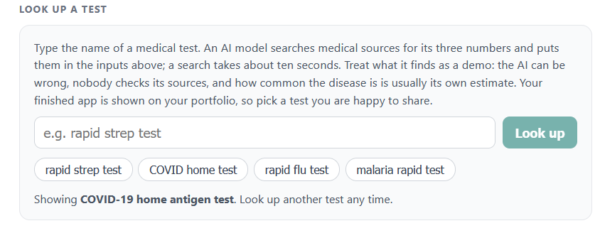

# 🩺 Medical Test Detective

An interactive web application built as part of Stanford University's **Probability for Artificial Intelligence** course. This tool demystifies medical diagnostics by applying **Bayes' Theorem** and frequency tree visualizations to evaluate the true reliability of various medical screenings and tests.

---

## ✨ Features

* **Interactive Test Analysis:** Explore pre-loaded medical tests (such as Screening Mammography, COVID-19 Home Antigen Tests, Stool DNA Tests, and Rapid HIV/Strep/Flu Tests) to see how statistics play out in real-world populations.
* **Bayes' Theorem Breakdown:** Breaks down complex conditional probabilities into intuitive natural frequencies (visualized across a population of 1,000 patients) to calculate $P(D|T)$—the true probability of having a disease given a positive test result.
* **False Positive & Negative Insights:** Uncovers counterintuitive statistical realities, highlighting why rare diseases often yield a high proportion of false positives even with highly accurate tests.
* **AI-Powered Custom Test Lookup:** Features a lookup tool that allows users to search for any medical test, dynamically estimating disease prevalence and test characteristics (sensitivity/specificity) to generate custom interactive test cards.

---

## 📸 App Preview

| Overview & Pre-loaded Tests | Bayes' Theorem Calculation & Probability Breakdown |
| :---: | :---: |
|  |  |

| The Inputs | Final Result |
| :---: | :---: |
|  |  |

---

## 🧠 Core Concepts & Mathematics

The app translates abstract probabilistic formulas into tangible frequency counts:
* **Prevalence $P(D)$:** How common the disease is in the target population.
* **Sensitivity $P(T|D)$:** The probability that the test is positive given that the patient has the disease.
* **Specificity $P(T^c|D^c)$:** The probability that the test is negative given that the patient *does not* have the disease.
* **Bayes' Theorem Application:** Combining these metrics to compute the posterior probability:

$$P(D|T) = \frac{P(T|D) \cdot P(D)}{P(T|D) \cdot P(D) + P(T|D^c) \cdot P(D^c)}$$

---

## 🛠️ Tech Stack & Concepts
* **Frontend:** Interactive UI components
* **Core Logic:** Probability theory, Bayesian inference, natural frequency scaling
* **Course:** Stanford University – Probability for Artificial Intelligence

---

## 📄 License

Distributed under the **MIT License**. See `LICENSE` for more information.
